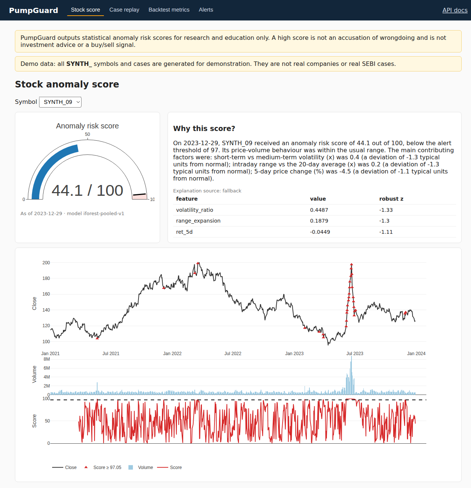
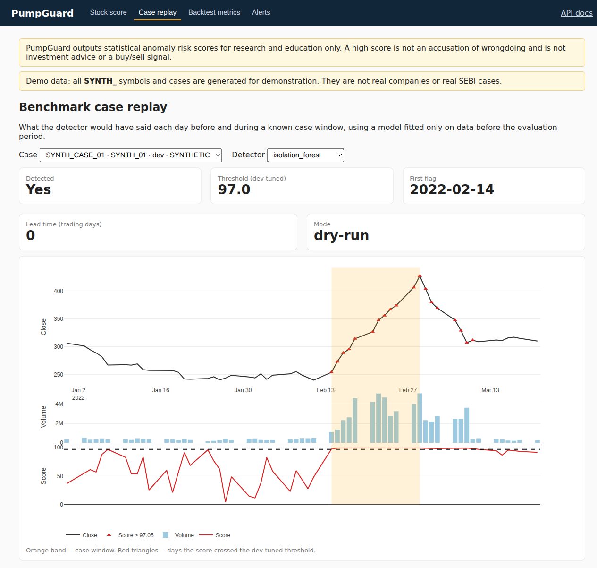
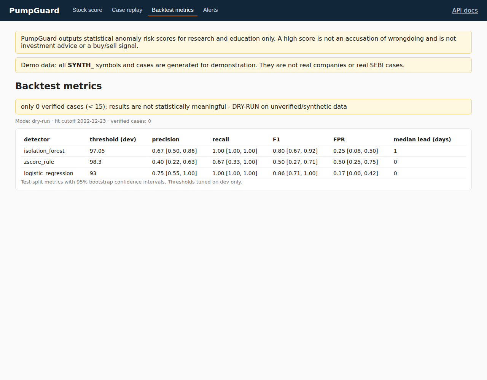
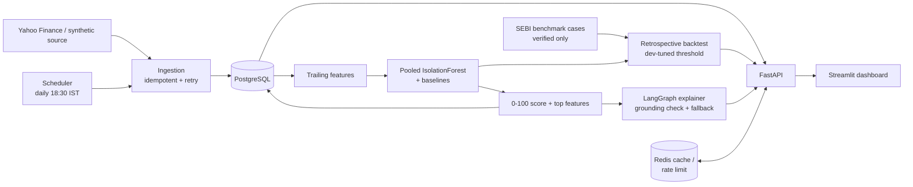

<div align="center">

# PumpGuard

**Retrospective detection of pump-and-dump signatures in Indian small/mid-cap stocks**

[](https://github.com/nileshrathore22/sebi-pumpguard/actions/workflows/ci.yml)


</div>

PumpGuard flags **statistically anomalous price-volume behaviour**, which is the quantitative signature of pump-and-dump schemes. It checks itself **retrospectively** against SEBI enforcement cases, and it uses an LLM **only to explain** scores that have already been computed.

> **The detector decides, the LLM only explains.** No look-ahead bias. No fabricated data. Not investment advice.

> [!IMPORTANT]
> PumpGuard outputs statistical anomaly risk scores for research and education only. A high score is not an accusation of wrongdoing and is not investment advice or a buy/sell signal.

---

## Table of contents

- [Screenshots](#screenshots)
- [Features](#features)
- [Architecture](#architecture)
- [Quickstart](#quickstart)
- [How it works](#how-it-works)
- [API](#api)
- [Evaluation](#evaluation)
- [What this project does NOT claim](#what-this-project-does-not-claim)
- [Tech stack](#tech-stack)
- [Repository layout](#repository-layout)
- [Documentation](#documentation)

---

## Screenshots

| Stock anomaly score | Benchmark case replay |
|---|---|
|  |  |

| Backtest metrics (synthetic dry run) |
|---|
|  |

All symbols shown are synthetic (`SYNTH_*`) demo data, not real companies.

---

## Features

- **Leakage-safe features.** 10 strictly trailing features, each measured relative to the stock's own history. A test mutates future rows and checks that past features do not change.
- **Explainable scoring.** A pooled IsolationForest produces a 0–100 percentile score plus the top contributing features.
- **Honest baselines.** The detector is compared against a z-score rule and a logistic regression trained on dev cases only.
- **Retrospective backtest.** Train/dev/test splits are chronological, and the threshold is tuned on dev only. Tuning on test raises `TestSplitLeakageError`.
- **Rigorous metrics.** Precision, recall, F1 and FPR with bootstrap 95% CIs, lead time, matched negative controls and a bias audit.
- **Grounded LLM explanations.** A LangGraph flow with a grounding check: any number or date not in the payload, or words like "manipulation" or "fraud", trigger a fallback to a deterministic template. It works without an API key.
- **Production-style API.** FastAPI with Pydantic schemas, one consistent error format, Redis caching and per-IP rate limiting.
- **Resilient ingestion.** Idempotent (`ON CONFLICT DO NOTHING`), exponential-backoff retries, per-symbol failure isolation, and a `pipeline_runs` audit table.
- **Fully containerised.** `make up` starts Postgres, Redis, the API, the scheduler and the dashboard, all with healthchecks.
- **CI.** Ruff, mypy, pytest with a coverage gate, a Docker build and a Compose smoke test.

---

## Architecture



The explainer runs these steps in order:

```
load_score_payload -> draft_explanation -> grounding_check -> format_response
                                         \-- on failure / no key --> deterministic template
```

More detail is in [docs/ARCHITECTURE.md](docs/ARCHITECTURE.md).

---

## Quickstart

### Option A: Docker (recommended, no API keys needed)

```bash
git clone https://github.com/nileshrathore22/sebi-pumpguard.git
cd sebi-pumpguard
cp .env.example .env     # optional; defaults work
make up                  # postgres, redis, api, scheduler, dashboard
```

The first start takes about 1–2 minutes. The API migrates the database and seeds a **synthetic** demo universe: `SYNTH_01` to `SYNTH_20`, 12 of them with injected pump patterns.

| Service | URL |
|---|---|
| Dashboard (Streamlit) | http://localhost:8501 |
| API docs (Swagger) | http://localhost:8000/docs |
| Lightweight web UI | http://localhost:8000/ |

```bash
curl localhost:8000/stocks/SYNTH_09/score
```

### Option B: Local development (Python 3.11 via [uv](https://github.com/astral-sh/uv))

```bash
make install                 # .venv + dev dependencies
make lint typecheck test     # ruff, mypy, pytest (no Postgres/Redis needed)
make backtest                # dry-run backtest on synthetic data -> artifacts/
```

### Option C: Single container (no Postgres/Redis)

```bash
DATABASE_URL=sqlite:////tmp/pumpguard.db DEMO_SEED_ON_STARTUP=true \
  uvicorn app.main:app --port 8000      # open http://localhost:8000/
```

---

## How it works

| Step | What happens | Why it is defensible |
|---|---|---|
| 1. Ingest | Daily OHLCV from Yahoo (`SYMBOL.NS`) or the synthetic generator | Idempotent, so re-runs never duplicate rows; one failing symbol does not stop the others |
| 2. Features | Volume z-scores (20/60 d), 1/3/5-day returns, volume-price divergence, range and volatility expansion, turnover vs median, consecutive up-days | Every feature uses only past data (`shift(1)` + rolling) and is normalised against the stock's own history |
| 3. Detect | One IsolationForest pooled across stocks; the score is the empirical percentile (0–100) | Unsupervised, so it needs no labels; pooling avoids learning a manipulated period as "normal" |
| 4. Threshold | Grid search maximising F1 on **dev** cases only | Test-split leakage raises an error in code |
| 5. Evaluate | Test-split P/R/F1/FPR, bootstrap CIs, lead time, matched negative controls | The model is fitted only on data before the first test window |
| 6. Explain | The LLM rephrases the precomputed payload, and a grounding checker validates it | The LLM never sees raw data and never decides anything |

Every design choice and the alternatives considered are recorded in [docs/DECISIONS.md](docs/DECISIONS.md) (D1–D17).

---

## API

| Method | Endpoint | Description |
|---|---|---|
| `GET` | `/health` | Database and cache status |
| `GET` | `/stocks` | Universe of tracked stocks |
| `GET` | `/stocks/{symbol}/score` | Latest score, threshold, top features, explanation |
| `GET` | `/stocks/{symbol}/history` | Price, volume and score time series |
| `GET` | `/cases` | Benchmark cases (synthetic ones are marked) |
| `GET` | `/cases/{case_id}/replay` | Day-by-day detector replay around a case window |
| `POST` | `/evaluate/backtest` | Run the retrospective backtest (official or dry-run) |
| `GET` | `/alerts` | Recent threshold crossings |

Every response includes the disclaimer. Errors share one shape: `{"error": {"code", "message"}, "disclaimer"}`. Full reference: [docs/API.md](docs/API.md).

---

## Evaluation

> [!WARNING]
> The repository ships with **no real SEBI cases**. The numbers below come from a **synthetic dry run** and are **not** evidence of real-world performance.

| Detector | Dev threshold | Test precision | Test recall | Test F1 [95% CI] | Test FPR |
|---|---:|---:|---:|---:|---:|
| IsolationForest | 97.05 | 0.67 | 1.00 | 0.80 [0.67, 0.92] | 0.25 |
| Z-score rule | 98.30 | 0.40 | 0.67 | 0.50 [0.27, 0.71] | 0.50 |
| Logistic regression | 93.00 | 0.75 | 1.00 | 0.86 [0.71, 1.00] | 0.17 |

**To produce the official result:**

1. Add 15–20 verified SEBI cases to `data/benchmark/cases_template.csv`, each with its order URL on `sebi.gov.in` and `verified=true`.
2. Run `make validate-cases`. Official mode rejects unverified and synthetic rows.
3. Run `make backtest-official`.

With fewer than 15 verified cases, every report carries a "not statistically meaningful" warning. See [docs/EVALUATION.md](docs/EVALUATION.md) and [docs/RUNBOOK.md](docs/RUNBOOK.md).

---

## What this project does NOT claim

- It does **not** detect manipulation, fraud or intent. It measures how *unusual* price-volume behaviour is. Results, news, index inclusion and corporate actions can also look unusual.
- A high score is **not** an accusation, **not** evidence, and **not** a buy/sell signal.
- It is **not** real-time surveillance. It uses end-of-day data.
- Synthetic results are **not** real-world performance.
- With 15–20 cases the confidence intervals are wide, so treat point estimates with caution.
- SEBI cases are a biased sample of schemes that were *caught*. See the bias audit in [EVALUATION.md](docs/EVALUATION.md#3-bias-audit).

---

## Tech stack

| Layer | Tools |
|---|---|
| API | FastAPI, Pydantic v2, Uvicorn |
| Data | PostgreSQL, SQLAlchemy 2, Alembic, Redis |
| ML / stats | pandas, NumPy, scikit-learn (IsolationForest, LogisticRegression) |
| Explanation | LangGraph, OpenAI-compatible client (optional), deterministic template |
| Dashboard | Streamlit, Plotly |
| Scheduling | APScheduler |
| Quality | pytest, pytest-cov, Ruff, mypy, pre-commit, GitHub Actions |
| Deployment | Docker, Docker Compose |

---

## Repository layout

```
app/
  ingestion/    fetchers (Yahoo, synthetic), retry, pipeline, benchmark loader
  features/     strictly trailing feature engineering
  detection/    IsolationForest, baselines, scoring, dev-only threshold
  evaluation/   backtest, negative controls, metrics + bootstrap CIs, reports
  explain/      payload, templates, LLM client, grounding check, LangGraph graph
  api/          FastAPI app, routers, schemas, errors, rate limit
  web/          lightweight HTML dashboard served at /
  cache/ db/    Redis cache, SQLAlchemy models, Alembic migrations
  jobs.py scheduler.py cli.py
dashboard/      Streamlit app (talks to the API only)
config/         universe.yaml (stock list, needs human confirmation)
data/benchmark/ cases_template.csv (real cases, human-filled), synthetic_cases.csv
docker/         Dockerfile + API entrypoint
docs/           architecture, API, evaluation, decisions, runbook, plan
tests/          leakage, threshold split, grounding, API, ingestion, backtest, ...
```

---

## Documentation

| Doc | Contents |
|---|---|
| [ARCHITECTURE.md](docs/ARCHITECTURE.md) | Components, data flow, deployment |
| [API.md](docs/API.md) | Endpoint reference and examples |
| [EVALUATION.md](docs/EVALUATION.md) | Methodology, metrics, bias audit |
| [DECISIONS.md](docs/DECISIONS.md) | Design decisions D1–D17 with alternatives |
| [RUNBOOK.md](docs/RUNBOOK.md) | Operating, adding SEBI cases, troubleshooting |
| [PLAN.md](docs/PLAN.md) | Phase-by-phase build plan |

---

<div align="center">
Final-year B.Tech CSE project · For research and education only · Not investment advice
</div>
